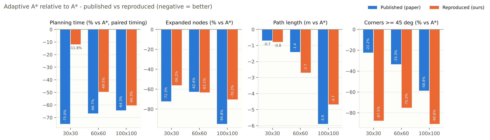
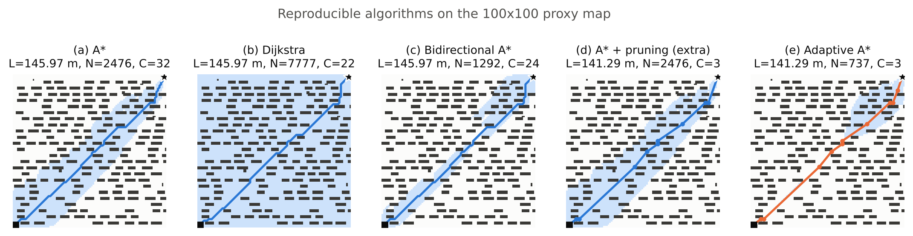
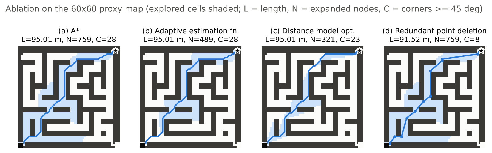
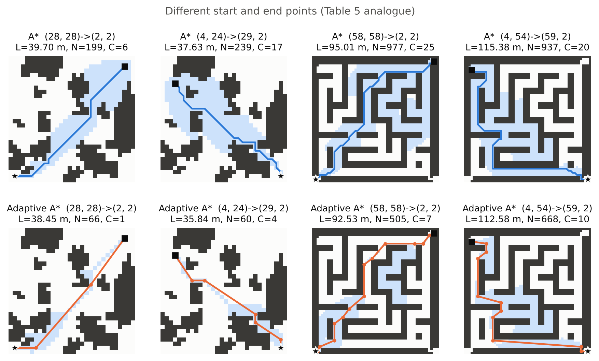
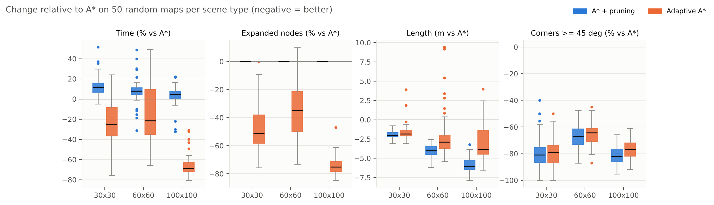

# Parts 4–6 — Independent Re-Implementation, Experimental Reproduction and Critical Analysis

> **Note:** this document describes the **first phase** of the study, run on *proxy* maps because the paper's maps were only available as a figure. The **final results**, on the paper's own maps digitised from its Fig. 5, are in [`03_paper_maps_reproduction.md`](03_paper_maps_reproduction.md).
>
> On the digitised maps two settings changed, both inferred from the paper's numbers: diagonal corner cutting is allowed, and pruning uses a Bresenham line of sight. The implementation description (§4) still applies.

All numbers below are produced by the scripts in this repository:
- `results/comparison.md` (every table, every algorithm);
- `results/timing_study.md` (paired timing);
- `results/robustness.md` (50 random maps per scene type);
- `maps/calibration.json` (proxy-map match).

Figures are in `figures/`.

---

## 4. Independent re-implementation

### 4.1 What was implemented, and where

| Paper element | Implementation | File / function |
|---|---|---|
| Grid map, 1 m cells (Sec. 2.1) | Boolean occupancy array, 8-connected moves (cost 1 / √2), no corner cutting | `grid.py` · `GridMap.neighbors` |
| Traditional A\* (Alg. 1, Eq. 1) | OPEN = binary heap, CLOSED = set, lazy deletion, no re-opening, stop when the goal is popped | `search.py` · `astar` |
| Distance models (Eqs. 2–4) | Euclidean, Manhattan, Chebyshev (plus octile for reference) | `heuristics.py` |
| **Adaptive estimation function** (Eqs. 5–6) | f = g + ω(n)·h(n), with ω = ln(1 + e^(d/D)) computed once per generated node | `heuristics.adaptive_weight`, `search.astar(weight=…)` |
| **Distance model optimisation** (Eq. 7) | h = (Euclidean + Manhattan) / 2 | `heuristics.hybrid` |
| **Redundant point deletion** (Sec. 3.3, Fig. 4) | Three-node window anchored at P_i. A collinear triple is deleted directly (Step 2); otherwise an exact supercover line-of-sight test decides (Step 3) | `smoothing.delete_redundant_points`, `line_of_sight` |
| Dijkstra [28] | A\* with h = 0 | `search.dijkstra` |
| Bidirectional A\* [30] | Alternating forward/backward A\*; stops at the first node closed by both searches | `search.bidirectional_astar` |
| Chen et al. [29], Zhang et al. [31] | **Not implemented** (the paper does not describe them). Compared on their published numbers only. | — |
| Metrics | Polyline length; corners = heading change ≥ 45°; expanded = size of CLOSED | `metrics.py` |
| Ablation switches | Every combination of {weight, heuristic, pruning} as a named planner | `planners.py` · `PLANNERS` |

### 4.2 Assumptions, modifications and deviations

| ID | Topic | Paper | This implementation | Why |
|---|---|---|---|---|
| D1 | **Maps** | 3 maps, shown only as figures | **Proxy maps**: procedurally generated maps of the same size and scene type, calibrated to the paper's *baseline* statistics (§5.2) | Original maps not published (M1) |
| D2 | Motion model | Not stated | 8-connected, cost 1 / √2, diagonal blocked if either orthogonal neighbour is an obstacle | M2, M3; safe for a robot |
| D3 | Baseline heuristic | "Traditional" | Euclidean (admissible, so the baseline A\* is optimal) | M5 |
| D4 | d and D in Eq. 6 | Not stated | Euclidean distances | M4 |
| D5 | Tie-breaking | Not stated | Lower f, then lower h, then FIFO (deterministic) | M8 |
| D6 | Line of sight | Not stated | Exact supercover; grazing an obstacle corner counts as a collision | M9; consistent with D2 |
| D7 | Pruning order | Ambiguous | **Anchor** mode (main): the anchor stays until line of sight is lost. A **single-pass** mode is kept as a sensitivity check. | M10 |
| D8 | Path length | Not stated, and inconsistent (doc 01 §8.3) | Euclidean length of the final polyline | M16 |
| D9 | Timing | MATLAB R2023b, 0.01 s resolution, runs not stated | Python 3.13. Median of 30 runs per configuration, plus a **paired interleaved study** (300 pairs) for the time metric. | M11 |
| D10 | Extra experiments | — | A\* + pruning, A\* + octile + pruning, and a 50-map robustness study with Wilcoxon tests | Needed for a fair comparison (§6) |

---

## 5. Experimental setup

### 5.1 Environment

| | Paper | Ours |
|---|---|---|
| Language | MATLAB R2023b | Python 3.13.16 (NumPy 2.5.3, pandas 3.0.5, SciPy 1.18.1, Matplotlib 3.11.2) |
| CPU | Intel Core i5-1340P @ 1.9 GHz, 16 GB | Intel Xeon @ 2.10 GHz (cloud VM, 4 vCPU) |
| OS | Windows 11 | Linux 6.18 |

### 5.2 Proxy maps and how closely they match

`archive/calibrate_maps.py` searched 12,000 / 6,000 / 2,400 seeded candidates for map1 / map2 / map3. It kept the candidate whose Dijkstra and A\* statistics were closest to the paper's. The proposed method is **never** used in calibration.

| Statistic (paper start/goal) | map1 30×30 paper | proxy | map2 60×60 paper | proxy | map3 100×100 paper | proxy |
|---|---|---|---|---|---|---|
| Dijkstra expanded nodes | 632 | 570 | 1740 | 1845 | 7520 | 7777 |
| Optimal length (Dijkstra) | 40.30 | 39.70 | 92.10 | 95.01 | 146.41 | 145.97 |
| A\* expanded nodes | 130 | **130** | 716 | 759 | 2191 | 2476 |
| A\* expanded, reversed start/goal | 202 | 199 | 898 | 977 | — | — |
| A\* expanded, random pair | 250 | 239 | 1159 | 937 | — | — |
| A\* length, random pair | 38.21 | 37.63 | 118.49 | 115.38 | — | — |
| A\* corners ≥ 45° | 9 | 8 | 12 | 28 | 34 | 32 |
| Obstacle ratio | — | 32.0% | — | 47.5% | — | 22.2% |

The baseline statistics agree within about 1–20%. The worst match is the corner count on the maze map (28 vs 12): our maze has narrower corridors than the paper's, so the grid path turns more often.

### 5.3 Protocol

- Every experiment of Tables 1–5 is run on the proxy maps with the paper's start/goal points.
- The algorithms are deterministic, so length, nodes and corners are exact. Time is the median of 30 runs.
- Because sub-millisecond single runs are noisy (the identical A\* run measured 0.93 ms in Table 1 and 0.62 ms in Table 2), **the time metric uses the paired, interleaved timing study** (`scripts/timing_study.py`): 300 alternating A\* / Adaptive A\* pairs per map with a bootstrap 95% CI.
- **Multiple runs and randomness:** the only stochastic elements are the maps and the timer. The algorithms are additionally evaluated on **50 unseen random maps per scene type** (150 maps), with paired Wilcoxon signed-rank tests.

---

## 6. Results and comparison with the published numbers

### 6.1 Headline metrics (the abstract's claims; mean over the three maps, Adaptive A\* vs A\*)

| Evaluation metric | Published result | Our result | Difference |
|---|---|---|---|
| **Metric 1** — Planning-time reduction | 68.7% | 40.5% (paired study: 11.8 / 49.5 / 60.3%) | −28.2 pp |
| **Metric 2** — Path-length reduction | 2.66 m | 2.72 m (0.78 / 2.70 / 4.67 m) | +0.06 m |
| **Metric 3** — Expanded-node reduction | 76.6% (72.3 / 62.6 / 94.8%) | 63.2% (56.2 / 63.1 / 70.2%) | −13.4 pp |
| **Metric 4** — Reduction of corners ≥ 45° | 38.1% (22.2 / 33.3 / 58.8%) | 84.4% (87.5 / 75.0 / 90.6%) | +46.3 pp |

### 6.2 Tables 2–4: Adaptive A\* in absolute terms

| Map | Metric | Paper A\* | Ours A\* | Paper Adaptive A\* | Ours Adaptive A\* | Difference (ours − paper) |
|---|---|---|---|---|---|---|
| 30×30 | Time (s) | 0.04 | 0.00063 | 0.01 | 0.00056 | Not comparable (MATLAB vs Python) |
| | Length (m) | 40.41 | 39.70 | 39.72 | 38.92 | −0.80 |
| | Expanded nodes | 130 | 130 | 36 | 57 | +21 |
| | Corners ≥ 45° | 9 | 8 | 7 | 1 | −6 |
| 60×60 | Time (s) | 0.18 | 0.0036 | 0.06 | 0.0018 | Not comparable |
| | Length (m) | 92.30 | 95.01 | 90.89 | 92.31 | +1.42 |
| | Expanded nodes | 716 | 759 | 268 | 280 | +12 |
| | Corners ≥ 45° | 12 | 28 | 8 | 7 | −1 |
| 100×100 | Time (s) | 0.70 | 0.0129 | 0.25 | 0.0051 | Not comparable |
| | Length (m) | 146.56 | 145.97 | 140.67 | 141.30 | +0.63 |
| | Expanded nodes | 2191 | 2476 | 113 | 737 | +624 |
| | Corners ≥ 45° | 34 | 32 | 14 | 3 | −11 |

Absolute times differ by one to two orders of magnitude. That reflects the language, interpreter and hardware, not the algorithm, so only **relative** time changes are compared.

### 6.3 Comparison with every baseline, including Chen et al. and Zhang et al. (published numbers only)

Change relative to the A\* of the same experiment. Negative = better; length in metres, others in percent.

| Map | Method | Time | Length | Expanded nodes | Corners ≥ 45° | Source |
|---|---|---|---|---|---|---|
| 30×30 | Dijkstra | +250% / +236% | −0.11 / 0.00 | +386% / +338% | +22% / −38% | paper / ours |
| | Bidirectional A\* | −25% / +12% | +2.24 / 0.00 | +20% / +5% | 0% / −38% | paper / ours |
| | **Chen et al. [29]** | −25% | +1.28 | −0.8% | 0% | **paper only** |
| | **Zhang et al. [31]** | 0% | −0.12 | −24.6% | +22% | **paper only** |
| | Adaptive A\* | −75% / −12% | −0.69 / −0.78 | −72.3% / −56.2% | −22% / −88% | paper / ours |
| 60×60 | Dijkstra | +117% / +72% | −0.20 / 0.00 | +143% / +143% | +8% / −14% | paper / ours |
| | Bidirectional A\* | 0% / +11% | +1.61 / 0.00 | −1.7% / +12.4% | 0% / −14% | paper / ours |
| | **Chen et al. [29]** | −33% | −0.22 | −2.8% | 0% | **paper only** |
| | **Zhang et al. [31]** | +33% | −0.19 | −27.0% | −17% | **paper only** |
| | Adaptive A\* | −67% / −50% | −1.41 / −2.70 | −62.6% / −63.1% | −33% / −75% | paper / ours |
| 100×100 | Dijkstra | +176% / +152% | −0.15 / 0.00 | +243% / +214% | −9% / −31% | paper / ours |
| | Bidirectional A\* | −46% / −45% | +1.82 / 0.00 | −48.6% / −47.8% | −6% / −25% | paper / ours |
| | **Chen et al. [29]** | −26% | 0.00 | −1.0% | 0% | **paper only** |
| | **Zhang et al. [31]** | −36% | 0.00 | −59.3% | −12% | **paper only** |
| | Adaptive A\* | −64% / −60% | −5.89 / −4.67 | −94.8% / −70.2% | −59% / −91% | paper / ours |

(Our time column for Adaptive A\* uses the paired study. The other "ours" times are 30-run medians.)

**Against Chen et al. and Zhang et al.:** we cannot run these methods, so we compare improvement relative to each paper's own A\*.

- **Expanded nodes:** our reproduced Adaptive A\* reduces nodes more than Chen (≤ 3%) and Zhang (25 / 27 / 59%) on every map.
- **Length:** it shortens paths more than both (0.8 / 2.7 / 4.7 m vs ≤ 0.22 m).
- **Corners:** it removes more corners than both.
- **Time:** it is faster than both on 60×60 and 100×100. On 30×30 our 12% time reduction is smaller than Chen's published 25%. At 0.04 s with 0.01 s resolution, though, Chen's 25% is a single timer tick.

So the paper's claim that Adaptive A\* outperforms these two methods **survives** in our reproduction, with the caveat that this compares relative improvements measured in different implementations.

### 6.4 Table 1: ablation (isolated: A\* + one change)

| Map | Change vs A\* (paper / ours) | Time | Length | Nodes | Corners |
|---|---|---|---|---|---|
| 30×30 | Adaptive estimation function | −25% / −21% | −0.21 / 0.00 | −9.2% / −5.4% | +44% / −13% |
| | Distance model optimisation | −50% / −74% | +1.04 / 0.00 | −65.4% / −73.8% | 0% / −25% |
| | Redundant point deletion | −50% / −19%\* | −1.67 / −0.78 | 0% / 0% | −44% / −88% |
| 60×60 | Adaptive estimation function | −50% / −23% | −0.25 / 0.00 | −42.5% / −35.6% | 0% / 0% |
| | Distance model optimisation | −33% / −54% | −1.22 / 0.00 | −3.5% / −57.7% | −17% / −18% |
| | Redundant point deletion | −33% / +8% | −4.81 / −3.49 | −3.5% / 0% | −42% / −71% |

\*Pruning only *adds* work to A\*, so a time decrease here is measurement noise. In the paired setting it costs +4 to +13% (robustness study). The paper's −50% / −33% for this row is not physically possible for isolated pruning. Its 60×60 row has exactly the node count and time of the distance-model row, which suggests that row was cumulative (doc 01 §8.4).

**The direction of every component is reproduced:**
- the adaptive weight and the hybrid heuristic reduce expanded nodes and time;
- pruning alone reduces length and corners and leaves nodes unchanged.

On 60×60 the hybrid heuristic alone is much stronger in our run (−58% vs −3.5%). This is consistent with the paper's 60×60 row being cumulative rather than isolated.

### 6.5 Table 5: different start and end points

| Map, start → goal | Time (paper / ours) | Length (m) | Nodes | Corners |
|---|---|---|---|---|
| 30×30, (28,28)→(2,2) | −67% / −58% | −0.38 / −1.25 | −78.7% / −66.8% | −54% / −83% |
| 30×30, (4,24)→(29,2) | −75% / −57% | −0.53 / −1.78 | −86.8% / −74.9% | −64% / −76% |
| 60×60, (58,58)→(2,2) | −84% / −32% | −3.27 / −2.49 | −86.3% / −48.3% | −63% / −72% |
| 60×60, (4,54)→(59,2) | −68% / 0% | −3.53 / −2.81 | −58.8% / −28.7% | −52% / −50% |

All four pairs improve on length, nodes and corners, as in the paper, but the node and time savings are smaller. On the maze map with the long detour pair, (4,54)→(59,2), the time saving disappears: the node reduction (−29%) is offset by the cost of the ω computation per node plus pruning.

### 6.6 Robustness on 150 random maps

The same calibrated generators were run with 50 unseen seeds per scene type. Values are means; W/T/L = maps where the method is lower / equal / higher than A\*; all p < 0.01 (Wilcoxon).

| Scene | Method | Time | Length | Nodes | Corners | Raw search path suboptimal |
|---|---|---|---|---|---|---|
| map1 (irregular) | Adaptive A\* | −21.8% (42/0/8) | −1.58 m (48/0/2) | −47.8% (50/0/0) | −78.0% | 16/50 maps (mean 1.1%, max 14.2%) |
| | A\* + pruning | +13.1% | −1.86 m (50/0/0) | 0% | −79.2% | — |
| map2 (maze) | Adaptive A\* | −13.8% (32/0/18) | −1.97 m (41/0/9) | −35.5% (49/0/1) | −65.5% | 27/50 maps (mean 2.0%, max 13.7%) |
| | A\* + pruning | +8.2% | −4.06 m (50/0/0) | 0% | −67.3% | — |
| map3 (array) | Adaptive A\* | −65.7% (50/0/0) | −2.84 m (45/0/5) | −74.0% (50/0/0) | −76.7% | 42/50 maps (mean 2.2%, max 6.9%) |
| | A\* + pruning | +3.7% | −5.79 m (50/0/0) | 0% | −82.0% | — |

**Adaptive A\* vs A\* + pruning, final length:** Adaptive A\* is **longer** on 22/50, 40/50 and 43/50 maps, by +0.28 m, +2.09 m and +2.95 m on average.

### 6.7 Sensitivity to the ambiguous pruning rule (D7)

| Experiment | Corners (anchor) | Corners (single-pass) | Length (anchor) | Length (single-pass) | Paper corners |
|---|---|---|---|---|---|
| 30×30 Adaptive A\* | 1 | 2 | 38.92 | 39.16 | 7 |
| 60×60 Adaptive A\* | 7 | 6 | 92.31 | 93.05 | 8 |
| 100×100 Adaptive A\* | 3 | 6 | 141.30 | 143.83 | 14 |

The interpretation of Sec. 3.3 changes corner counts by up to 2× and length by up to 2.5 m. Neither reading reaches the paper's relatively high corner counts after pruning. This suggests the authors' line-of-sight check was more conservative (for example, a safety margin), and that check is not described.

---

## 7. Critical analysis

### 7.1 Verdict per metric

| Metric | Verdict | Short justification |
|---|---|---|
| Path length | **(A) Comparable** | Mean reduction 2.72 m vs 2.66 m; same sign on all 7 experiments and on 134/150 random maps |
| Expanded nodes | **(A)–(C) Comparable trend, lower magnitude** | Matches on 60×60 (−63.1% vs −62.6%); lower on 30×30 (−56% vs −72%) and 100×100 (−70% vs −95%) |
| Planning time | **(C) Lower** | 40.5% vs 68.7% mean reduction; close on 60×60 and 100×100, far lower on 30×30 |
| Corners ≥ 45° | **(B) Numerically higher, but not an improvement of the method** | 84% vs 38%. Caused by our pruning interpretation and line-of-sight rule (§6.7), not by a better algorithm |
| **Overall** | **(A) Comparable, qualitative reproduction** | All claimed effects have the right sign and are statistically significant over 150 maps, but magnitudes differ and the *source* of the gains differs from the paper's narrative |

A higher corner reduction is **not** claimed as an improvement. It comes from a different, equally valid reading of an under-specified step. Likewise, the lower time reduction is **not** a failed reproduction: it is explained below by measurable factors.

### 7.2 Technical justification of the differences

**1. Dataset version, availability and preprocessing.** The paper's maps are unavailable, so we used calibrated proxies (D1). The baseline statistics match within about 1–20% (§5.2), but obstacle *layout* still drives the results.
- **Spread across maps:** the node reduction of Adaptive A\* varies from −36% to −74% across scene types and has a standard deviation of 7–22 pp across maps of the *same* type (§6.6).
- **What this means:** a single published map per size is therefore one draw from a wide distribution. The paper's 94.8% node reduction on 100×100 (113 expanded nodes for a 97-step diagonal route) lies outside our 50-map distribution: the best case there is −84.7%. That suggests their array map leaves a much more open diagonal corridor.

**2. Experimental settings and parameters.** The motion model and the corner-cutting rule (D2), the line-of-sight rule (D6) and the pruning order (D7) are not given in the paper.
- **Pruning and line of sight:** these two settings alone move corner counts by up to 2× (§6.7). This explains most of the corner difference.
- **Length metric:** the paper's length metric does not decompose into 1 / √2 grid steps, and its "A\*" is longer than its Dijkstra on every map (doc 01 §8.3). So the paper's baseline is not optimal under its own metric, which inflates its reported length gains slightly. Our baseline A\* is provably optimal (unit test `test_astar_matches_dijkstra_on_random_maps`).

**3. Randomness and seeds.**
- **Deterministic metrics:** all searches are deterministic (fixed tie-breaking), so length, nodes and corners are exactly repeatable. Map randomness is controlled by recorded seeds (`maps/calibration.json`, seeds 900001+ for robustness).
- **Time:** time is the only noisy metric. The same A\* run differed by 50% between two 30-run batches. We therefore used 300 interleaved pairs; the 95% CIs are narrow, e.g. [0.502, 0.509] for 60×60.
- **The paper's timing:** the paper reports one value per configuration at 0.01 s resolution. Its 30×30 result "0.04 → 0.01 s = 75%" is compatible with any true reduction between about 57% and 89%, so its time percentages carry a quantisation error of roughly ±16 pp.

**4. Software, framework and hardware.** MATLAB vs CPython changes the *cost structure* of the algorithm.
- **Fixed per-node overhead:** in Python, evaluating ω = ln(1 + e^(d/D)) for each generated node, plus the line-of-sight checks of pruning, is a significant fixed overhead. Pruning alone adds 4–13% to A\* time (§6.6).
- **Small vs large maps:** on the 30×30 map Adaptive A\* expands 56% fewer nodes but saves only 12% of the time, because the search takes about 0.6 ms and the overheads are a large share of it. On 100×100 the search dominates, and the time reduction (60%) tracks the node reduction (70%) and is close to the paper's 64%.
- **Better efficiency metric:** expanded nodes are a hardware-independent measure of search effort and are the fairer comparison.

**5. Missing or ambiguous details in the paper.** These are listed in doc 01, items M1–M17. The ones that affect the numbers most are:
- the maps (M1);
- "traversed nodes" (M6);
- the line-of-sight and pruning rules (M9, M10);
- the length definition (M16);
- whether the ablation rows were isolated or cumulative (M17).

**6. Deviations introduced by us.** The most significant ones:
- Proxy maps (D1).
- A conservative no-corner-cutting rule (D2, D6). This makes paths slightly longer and safer than with corner cutting, for every method alike.
- Paired timing (D9).
- None of these favours or penalises the proposed method relative to the baselines, because they apply to every planner equally.

### 7.3 What the reproduction reveals about the paper's claims

1. **The efficiency claim holds (direction and significance).** The adaptive weight together with the hybrid heuristic reduces expanded nodes on 149/150 random maps and time on 124/150. The mechanism is heuristic inflation: ω ≤ 1.31 times a hybrid that overestimates by up to 21% (Fig. `fig_weight_heuristic.png`) gives up to about 1.59× inflation, which behaves like weighted A\*.
2. **The optimality claim does not hold.** The paper says the method keeps "the optimal trend". In fact, the raw Adaptive A\* search path is **suboptimal on 85 of 150 maps** (up to 14% longer). This is the expected price of an inadmissible heuristic.
3. **The length and smoothness gains come from pruning, not from the adaptive search.** Without pruning, Adaptive A\* is never shorter than A\* (by construction it cannot be). With pruning, plain **A\* + pruning is shorter than Adaptive A\* on 105 of 150 maps.** The paper's own Table 1 shows the same pattern: 38.74 m for pruning alone vs 39.72 m for the full method on 30×30, and 87.49 m vs 90.89 m on 60×60.
4. **There is a real trade-off.** Adaptive A\* is the best *speed vs path-quality* compromise: about 60–75% fewer nodes than A\* on large maps, with corners and length close to the A\* + pruning optimum. It is not the method that yields the "shortest path", as the paper's conclusion states.
5. **Ranking against the other algorithms is reproduced.** Dijkstra is slowest and expands the most nodes. Bidirectional A\* helps on open maps (100×100) but not in the maze. The published improvements of Chen et al. and Zhang et al. relative to A\* are smaller than our reproduced improvements of Adaptive A\* on nodes, length and corners (§6.3).

---

## 8. Limitations of this reproduction

- **Proxy maps, not the original maps.** Absolute numbers (and the magnitude of the node reduction on 100×100) depend on them. The pipeline accepts digitised maps unchanged (`maps/map*.csv`) if the original figures become available in sufficient resolution.
- **Chen et al. and Zhang et al. were not re-implemented.** Their comparison uses published relative improvements, measured with the authors' implementation and maps.
- **Python timing ≠ MATLAB timing.** Relative times are comparable only to the extent that per-node overheads scale similarly. Expanded nodes is the preferred efficiency metric.
- **Static grid only.** As in the paper, there is no robot footprint, kinematic model or dynamic obstacles.
